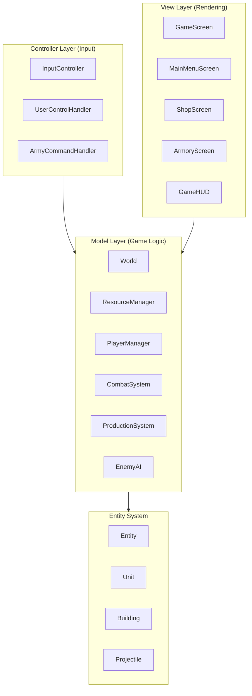
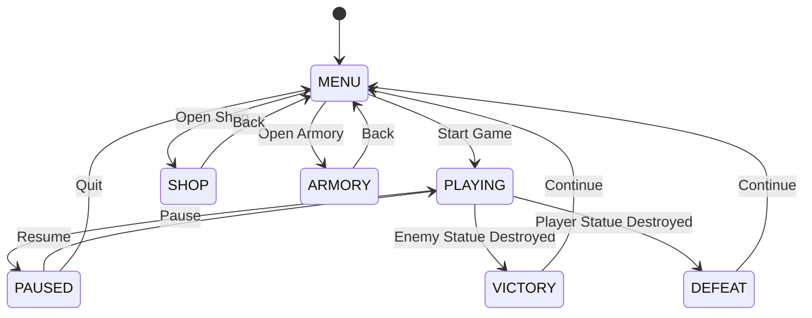

# Design Document: Stick War Legacy Clone

## Overview

This design document outlines the architecture and implementation details for a Stick War Legacy-inspired real-time strategy game built with Java 11 and LibGDX 1.12.1. The game is a side-scrolling RTS where players mine gold, train units, and battle to destroy the enemy CommandCenter. The project provides a skeleton implementation following MVC architecture for a 4-person development team to complete.

**Core Features (Required for Grade):**
- 4 unit types: Miner, Swordwrath, Archidonis, Spearton (with shield defense)
- 3 building types: CommandCenter, Barracks, Mine
- Gold-based economy (mines produce gold)
- Combat system with java.util.Random for damage variance
- Territory expansion via TerritoryManager
- Main menu with Scene2D buttons
- GameHUD displaying resources, frontline bar, notifications

**Reward System:**
- Gems: Awarded for winning battles (used in Shop for cosmetics)
- Upgrade Points: Awarded for winning battles (used in Armory for unit upgrades)
- Gold: Primary in-game resource from Mines (used for unit production)

## Architecture

The project follows the Model-View-Controller (MVC) architectural pattern to separate concerns and enable parallel development by team members.



### Package Structure

```
com.stickwar.legacy/
├── core/
│   ├── GameMain.java              # Main game class extending Game
│   └── GameState.java             # Enum: MENU, PLAYING, VICTORY, DEFEAT
├── world/
│   ├── Tile.java                  # Map tile with owner, type, position
│   ├── GameMap.java               # 2D grid of tiles
│   ├── TerritoryManager.java      # Calculates frontline, updates Tile.owner
│   └── TileType.java              # Enum: GRASS, MOUNTAIN, WATER
├── entities/
│   ├── Entity.java                # Abstract base entity class
│   ├── Unit.java                  # Abstract unit base class
│   ├── units/
│   │   ├── Miner.java             # Gold gathering unit
│   │   ├── Swordwrath.java        # Basic melee unit
│   │   ├── Archidonis.java        # Ranged archer unit
│   │   └── Spearton.java          # Shield unit (defense=0.7f)
│   └── buildings/
│       ├── Building.java          # Abstract building base class
│       ├── CommandCenter.java     # Main base (no production)
│       ├── Barracks.java          # Spawns units instantly
│       └── Mine.java              # Produces Gold
├── resources/
│   └── ResourceManager.java       # Map<String, Integer> for Gold
├── systems/
│   ├── CombatSystem.java          # Combat with Random damage variance
│   └── UnitFactory.java           # Factory pattern for unit creation
├── screens/
│   ├── MainMenuScreen.java        # New Game, Options, Quit (Scene2D)
│   ├── GameScreen.java            # Main gameplay screen
│   └── OptionsScreen.java         # Volume stub
└── ui/
    └── GameHUD.java               # Resources, frontline bar, notifications
```

## Components and Interfaces

### Core Components

#### GameMain
The entry point extending LibGDX's `Game` class. Manages screen transitions and global game state.

```java
public class GameMain extends Game {
    private GameState currentState;
    
    @Override
    public void create() {
        setScreen(new MainMenuScreen(this));
    }
    
    public void startGame() { 
        setScreen(new GameScreen(this));
    }
    
    public void returnToMenu() { 
        setScreen(new MainMenuScreen(this));
    }
    
    public void showVictory(int gemsEarned, int upgradePointsEarned) { }
}
```

#### GameMap
2D grid of tiles representing the battlefield. Uses nested loops for iteration.

```java
public class GameMap {
    private Tile[][] tiles;
    private int width, height;
    
    public GameMap(int width, int height) {
        this.width = width;
        this.height = height;
        tiles = new Tile[width][height];
        generateMap();
    }
    
    private void generateMap() {
        // TerritoryManager must iterate 2D
        for (int x = 0; x < width; x++) {
            for (int y = 0; y < height; y++) {
                tiles[x][y] = new Tile(x, y, TileType.GRASS);
            }
        }
    }
}
```

#### TerritoryManager
Calculates frontline and updates tile ownership based on unit positions.

```java
public class TerritoryManager {
    private GameMap map;
    
    /**
     * Updates tile ownership based on unit positions.
     * Iterates through 2D grid to calculate frontline.
     */
    public void updateFrontline(Player player, List<Unit> units) {
        int maxX = 0;
        for (Unit unit : units) {
            if (unit.getOwner() == player) {
                maxX = Math.max(maxX, (int) unit.getX());
            }
        }
        // Update ownership for all tiles up to frontline
        for (int x = 0; x < map.getWidth(); x++) {
            for (int y = 0; y < map.getHeight(); y++) {
                if (x <= maxX) {
                    map.getTile(x, y).setOwner(player);
                }
            }
        }
    }
}
```

### Entity System

#### Entity (Abstract Base)
```java
public abstract class Entity {
    protected int id;
    protected float x, y;
    protected int hp, maxHp;
    protected Player owner;
    protected boolean markedForRemoval;
    
    public void takeDamage(int damage) {
        hp -= damage;
        if (hp <= 0) {
            onDeath();
            markedForRemoval = true;
        }
    }
    
    public abstract void update(float deltaTime);
    public abstract void render(SpriteBatch batch);
    protected abstract void onDeath();
}
```

#### Unit (Abstract)
```java
public abstract class Unit extends Entity {
    protected int attackPower;
    protected float moveSpeed;
    protected int cost;
    protected UnitState state;
    protected UnitType type;
    protected float attackRange;
    protected float attackCooldown;
    protected boolean isUserControlled;
    
    // User Control modifiers
    protected static final float UC_DAMAGE_MULTIPLIER = 2.0f;
    protected static final float UC_SPEED_MULTIPLIER = 1.2f;
    
    public void move(float deltaTime) { }
    public void attack(Entity target) { }
    public void setUserControlled(boolean controlled) { }
    
    public int getEffectiveAttackPower() {
        return isUserControlled ? (int)(attackPower * UC_DAMAGE_MULTIPLIER) : attackPower;
    }
    
    public float getEffectiveMoveSpeed() {
        return isUserControlled ? moveSpeed * UC_SPEED_MULTIPLIER : moveSpeed;
    }
}
```

#### Building (Abstract)
```java
public abstract class Building extends Entity {
    protected Map<String, Integer> cost;
    
    public Building(float x, float y, Player owner) {
        this.x = x;
        this.y = y;
        this.owner = owner;
    }
}
```

### Unit Implementations

| Unit | HP | Attack | Speed | Cost | Special |
|------|-----|--------|-------|------|---------|
| Miner | 50 | 5 | 80 | 150 | Gold carrying (50 capacity) |
| Swordwrath | 100 | 20 | 100 | 200 | Melee, basic fighter |
| Archidonis | 80 | 15 | 90 | 350 | Ranged archer |
| Spearton | 150 | 20 | 70 | 500 | Shield defense (damage * 0.7f) |

### Resource Management

```java
public class ResourceManager {
    private Map<String, Integer> resources;
    
    public ResourceManager() {
        resources = new HashMap<>();
        resources.put("Gold", 0);
    }
    
    public void addGold(int amount) {
        resources.put("Gold", resources.get("Gold") + amount);
    }
    
    public boolean spendGold(int amount) {
        int current = resources.get("Gold");
        if (current >= amount) {
            resources.put("Gold", current - amount);
            return true;
        }
        return false;
    }
    
    public int getGold() {
        return resources.get("Gold");
    }
}
```

### Factory Pattern

```java
public class UnitFactory {
    private ArmoryManager armory;
    
    public Unit createUnit(UnitType type, Player owner) {
        Unit unit = switch (type) {
            case MINER -> new Miner(owner);
            case SWORDWRATH -> new Swordwrath(owner);
            case ARCHIDON -> new Archidon(owner);
            case SPEARTON -> new Spearton(owner);
            case MAGIKILL -> new Magikill(owner);
            case GIANT -> new Giant(owner);
            default -> throw new IllegalArgumentException("Unknown unit type");
        };
        applyUpgrades(unit);
        return unit;
    }
    
    private void applyUpgrades(Unit unit) {
        // Apply armory upgrades to unit stats
    }
}
```

### Combat System

```java
/**
 * Combat system with random damage variance.
 * Requirement: PDF 4.5 - prise en compte d'aléatoire
 */
public class CombatSystem {
    private Random random = new Random();
    
    /**
     * Calculates damage with random variance.
     * @param attacker The attacking unit
     * @param target The target entity
     * @return Calculated damage with variance
     */
    public int calculateDamage(Unit attacker, Entity target) {
        int baseDamage = attacker.getAttackPower();
        // Add random variance: base + random(0-5)
        int damage = baseDamage + random.nextInt(6);
        
        // Apply Spearton shield defense (30% reduction)
        if (target instanceof Spearton) {
            Spearton spearton = (Spearton) target;
            damage = (int)(damage * spearton.getDefenseMultiplier()); // 0.7f
        }
        
        return damage;
    }
    
    public void processAttack(Unit attacker, Entity target) {
        int damage = calculateDamage(attacker, target);
        target.takeDamage(damage);
    }
}
```

### Barracks (Unit Spawning)

```java
/**
 * Barracks building that spawns units instantly when gold is available.
 */
public class Barracks extends Building {
    private UnitFactory factory;
    private ResourceManager resources;
    
    /**
     * Spawns a unit instantly if resources are available.
     * @param unitType Type of unit to spawn
     * @param spawnTile Tile where unit appears
     * @return The spawned unit, or null if insufficient gold
     */
    public Unit spawnUnit(String unitType, Tile spawnTile) {
        int cost = factory.getUnitCost(unitType);
        if (resources.spendGold(cost)) {
            Unit unit = factory.createUnit(unitType, this.getOwner());
            unit.setPosition(spawnTile.getX(), spawnTile.getY());
            return unit;
        }
        return null;
    }
}
```

### Mine (Gold Production)

```java
/**
 * Mine building that produces Gold over time.
 */
public class Mine extends Building {
    private int goldPerTick = 10;
    private float tickTimer = 0;
    private float tickInterval = 2.0f; // seconds
    
    public void update(float deltaTime, ResourceManager resources) {
        tickTimer += deltaTime;
        if (tickTimer >= tickInterval) {
            resources.addGold(goldPerTick);
            tickTimer = 0;
        }
    }
}
```

## Data Models

### Unit Stats (Hardcoded Constants)
```java
public class UnitStats {
    // Miner
    public static final int MINER_HP = 50;
    public static final int MINER_ATTACK = 5;
    public static final int MINER_SPEED = 80;
    public static final int MINER_COST = 150;
    public static final int MINER_GOLD_CAPACITY = 50;
    
    // Swordwrath
    public static final int SWORDWRATH_HP = 100;
    public static final int SWORDWRATH_ATTACK = 20;
    public static final int SWORDWRATH_SPEED = 100;
    public static final int SWORDWRATH_COST = 200;
    
    // Archidonis
    public static final int ARCHIDONIS_HP = 80;
    public static final int ARCHIDONIS_ATTACK = 15;
    public static final int ARCHIDONIS_SPEED = 90;
    public static final int ARCHIDONIS_COST = 350;
    
    // Spearton (copy of Swordwrath but hp=150, defense=0.7f)
    public static final int SPEARTON_HP = 150;
    public static final int SPEARTON_ATTACK = 20;
    public static final int SPEARTON_SPEED = 70;
    public static final int SPEARTON_COST = 500;
    public static final float SPEARTON_DEFENSE = 0.7f;
}
```

### Tile Types
```java
public enum TileType {
    GRASS,      // Normal terrain
    MOUNTAIN,   // Impassable
    WATER       // Impassable (unless bridge)
}
```

### Game State Diagram




## Correctness Properties

*A property is a characteristic or behavior that should hold true across all valid executions of a system-essentially, a formal statement about what the system should do. Properties serve as the bridge between human-readable specifications and machine-verifiable correctness guarantees.*

Based on the core requirements, the following correctness properties must be verified:

### Property 1: Entity Damage and Death Consistency
*For any* Entity with initial hp > 0 and any damage amount, calling takeDamage(damage) should reduce hp by exactly the damage amount, and if the resulting hp <= 0, the entity should be marked for removal.

**Validates: Requirements 6.2, 6.3**

### Property 2: Unit Cost Hierarchy
*For any* two unit types A and B where A appears before B in the ordering (Miner, Swordwrath, Archidonis, Spearton), the cost of A should be strictly less than the cost of B.

**Validates: Requirements 13.1**

### Property 3: Resource Manager Round-Trip
*For any* ResourceManager and any positive integer amount, calling addGold(amount) followed by getGold() should return a value that includes the added amount. For any starting balance and spend amount where balance >= spend, spendGold(spend) should return true and reduce balance by exactly spend.

**Validates: Requirements 19.2, 19.3, 19.4**

### Property 4: Spearton Shield Defense
*For any* Spearton receiving damage D, the actual damage taken should be D * 0.7 (30% reduction).

**Validates: Requirements 10.2**

### Property 5: Combat Damage Variance
*For any* attack with base damage D, the actual damage dealt should be within the range [D, D + 5] (base + random(0-5)).

**Validates: Requirements 20.1**

### Property 6: Win/Lose State Transitions
*For any* game state where player CommandCenter hp <= 0, the GameState should transition to DEFEAT. For any game state where enemy CommandCenter hp <= 0, the GameState should transition to VICTORY.

**Validates: Requirements 16.2, 16.3**

### Property 7: Barracks Unit Spawning
*For any* unit type with cost C, when Barracks.spawnUnit() is called with gold G >= C, the gold should be reduced by C and a unit should be created. When G < C, no unit should be created and gold should remain unchanged.

**Validates: Requirements 21.1, 21.2**

### Property 8: Territory Frontline Calculation
*For any* set of player units, the TerritoryManager should set ownership for all tiles with x <= max(unit.x) to the player.

**Validates: Requirements 3.1, 3.2**

## Error Handling

### Input Validation
- **Negative values**: All damage, gold, and stat values must be non-negative. Negative inputs should be clamped to 0 or throw IllegalArgumentException.
- **Null entities**: Combat and interaction methods must check for null targets and handle gracefully.
- **Invalid unit types**: UnitFactory should throw IllegalArgumentException for unknown unit types.

### Resource Errors
- **Insufficient gold**: spendGold() returns false; UI should display notification.
- **Insufficient gems**: purchase() returns false; UI should display notification.
- **Insufficient upgrade points**: purchaseUpgrade() returns false; UI should display notification.

### Game State Errors
- **Invalid state transitions**: GameState changes should be validated (e.g., cannot go from MENU directly to VICTORY).
- **Entity not found**: Operations on removed entities should be no-ops.

### Persistence Errors
- **Save/Load failures**: SaveManager should catch IOExceptions and provide fallback behavior (default values for new players).

## Testing Strategy

### Testing Framework
The project will use **JUnit 5** for all testing, which comes standard with LibGDX Gradle projects. Property-based tests will be implemented using `@RepeatedTest` annotations combined with `java.util.Random` for generating test inputs.

### Property Test Configuration
- Each property test MUST run a minimum of **100 iterations** using `@RepeatedTest(100)`
- Each property test MUST be tagged with a comment referencing the correctness property: `**Feature: stick-war-legacy-clone, Property {number}: {property_text}**`

### Example Property Test Structure
```java
// **Feature: stick-war-legacy-clone, Property 1: Entity Damage and Death Consistency**
@RepeatedTest(100)
void entityDamageReducesHpCorrectly() {
    Random random = new Random();
    int initialHp = random.nextInt(1000) + 1;  // 1-1000
    int damage = random.nextInt(500);           // 0-499
    
    Entity entity = new TestEntity(initialHp);
    entity.takeDamage(damage);
    
    assertEquals(initialHp - damage, entity.getHp());
    if (initialHp - damage <= 0) {
        assertTrue(entity.isMarkedForRemoval());
    }
}
```

### Unit Testing
Unit tests complement property tests by verifying:
- Specific edge cases (zero values, boundary conditions)
- Integration points between components
- UI behavior that cannot be property tested

### Test Organization
```
src/test/java/com/stickwar/legacy/
├── entities/
│   ├── EntityTest.java              # Property 1
│   └── UnitTest.java                # Properties 2, 4
├── resources/
│   └── ResourceManagerTest.java     # Property 3
├── systems/
│   ├── CombatSystemTest.java        # Property 5
│   └── BarracksTest.java            # Property 7
├── world/
│   └── TerritoryManagerTest.java    # Property 8
└── core/
    └── GameStateTest.java           # Property 6
```

### Test Coverage Goals
- All correctness properties must have corresponding JUnit 5 tests
- Critical paths (combat, resource management, unit spawning) should be tested
- Use @RepeatedTest(100) for property-based testing with Random
